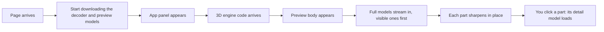

# The master guide: how Anatomy Explorer works, in very simple words

This guide explains the whole project as if you have never seen 3D graphics before. Every idea comes with a picture in words. When you want to see the real thing, each section ends with where it lives in the code.

## 1. The app in one minute

Anatomy Explorer is a see-through human body that lives in a web page. You can spin it, zoom in, and click any part to learn its name. It runs at https://vrisha-anatomy.netlify.app.

It has three modes, picked with the buttons at the top of the side panel:

| Mode             | What you do                             | What you get                                             |
| ---------------- | --------------------------------------- | -------------------------------------------------------- |
| **Explore**      | Click any of 1,046 body parts           | Its name, a description and facts                        |
| **Stretches**    | Pick muscles on the body or from a list | 163 stretches, best match first, with the muscles lit up |
| **Nerve glides** | Pick nerves                             | 26 nerve glides, with the nerves lit up                  |

On top of that, the body can move: a yoga backbend, a moonwalk and a cartwheel. It also breathes gently when it stands still.

## 2. What we built, in order

| When       | What happened                                                                                                                       |
| ---------- | ----------------------------------------------------------------------------------------------------------------------------------- |
| 2026-11-14 | A real 3D skeleton in the browser: 231 bones and teeth you can click                                                                |
| 2026-11-16 | 435 muscles added on the same body, plus a cleaner viewer                                                                           |
| 2026-11-16 | Five inside systems: heart and vessels, lungs, gut, kidneys and bladder, brain                                                      |
| 2026-11-16 | 282 nerves from a second source, fitted onto the same body; the site goes live on Netlify                                           |
| 2026-11-18 | Stretch guide and nerve-glide guide                                                                                                 |
| 2026-11-18 | Much faster loading: small preview models first, real ones after, and caching for repeat visits                                     |
| 2026-11-18 | The body learns to move: a 20-bone rig with three movements                                                                         |
| 2026-11-23 | Everything committed to `main`, then this tidy-up: an anatomy-only repository, clear folders, plans folder, agent rules, these docs |

## 3. What a 3D model is

Imagine a connect-the-dots drawing, but in the air instead of on paper. Each dot has three numbers: how far left or right, how far up or down, how far forward or back. Those dots are called **vertices**.

Now join every three nearby dots with a tiny flat paper triangle. Stick enough triangles together and you get a surface, like a bone or a muscle. The whole skeleton here is made of 2,037,126 little triangles.

Each surface also gets a **name tag**. The left semitendinosus (a hamstring muscle) is tagged `FMA22359`. That tag is how the app knows what you clicked.

A **GLB file** is a lunchbox that holds the dots, the triangles and the name tags together. The browser opens the lunchbox and draws what is inside.

## 4. Where the body parts come from

We did not draw any body parts ourselves. Drawing anatomy by hand would be guessing, and guessing is how wrong anatomy sneaks in.

- **BodyParts3D** gives the bones, muscles and organs. It is a free, published library of the body parts of one adult male, made by the Database Center for Life Science in Japan. Every part is already named.
- **Z-Anatomy** gives the nerves. It is an open anatomy atlas, partly built from BodyParts3D.

Both libraries let us share our changes as long as we credit them and share alike. The credits live in `public/models/ATTRIBUTION.md`, and the app links to them from the panel's footer.

**Making the two sources agree.** Imagine two maps of the same city drawn at slightly different sizes. To lay one on the other, you find landmarks that appear on both, like the same 99 bones, and slide and shrink one map until the landmarks line up. We did exactly that for the nerves. The landmarks now line up to within 0.8 mm on a typical bone.

**Turning everything the right way up.** The source files measure in millimetres and treat "up" as a different direction from web 3D. So every dot goes through one fixed recipe: swap two directions, flip one, divide by 1,000 to get metres, and lift the body 4 mm so the feet rest on the floor. Every part goes through the same recipe, so nothing drifts apart.

## 5. The factory: from downloaded parts to web models

Raw anatomy files are too big and too raw for a web page. So the project has a little factory, the **asset pipeline**, in the `asset-pipeline/` folder. Think of it as a kitchen:

1. **Shopping list (select).** A pinned list says exactly which parts we use, by name tag. It lives in `asset-pipeline/data/`.
2. **Shopping (fetch).** A script downloads only those parts and checks each one's fingerprint (a checksum), so a broken download can never sneak in.
3. **Cooking (build).** A script applies the "right way up" recipe, glues together dots that sit on top of each other, works out which way each triangle faces so light looks right, and groups the parts by body region.
4. **Vacuum sealing (compress).** Google's **Draco** squeezes the shapes so they download faster. It stores each dot a little less precisely, so tiny you cannot see it, and the files shrink a lot.
5. **Snack-size copies (previews).** A script makes a tiny copy of every region file with about 6% of its triangles. Every name tag stays.
6. **Taste test (checks).** Robots in `checks/` make sure the counts, positions, names and sizes are right.

The factory writes two kinds of output: the lunchboxes in `public/models/`, and a **catalogue** in `src/anatomy/generated/`. The catalogue is a list of every part with its name, system, region and facts. Nobody edits those files by hand. If something is wrong, we fix the recipe and run the factory again.

## 6. Three sizes of every part

Every part can arrive in up to three sizes, like a photo you can see as a thumbnail, a normal picture and a zoomed close-up.

| Size         | What it is                                     | When it loads                 | Example                             |
| ------------ | ---------------------------------------------- | ----------------------------- | ----------------------------------- |
| **Preview**  | About 6% of the triangles, every name kept     | First, so you see a body fast | 1.7 MB for the whole default view   |
| **Overview** | The normal model, grouped into region files    | Right after the previews      | 19 MB for skeleton plus muscles     |
| **Detail**   | The full-resolution surface of one single part | Only when you click that part | One muscle, about 130 KB on average |

The app always shows the best size it has for each part. When a bigger size arrives, it swaps in on the spot, and the surface simply looks sharper.

## 7. What happens when you open the page

Here is the story of the first two seconds, step by step.



1. **The page arrives.** It is tiny. Its first job is to shout "start downloading these now!" for the Draco decoder and the preview models of the mode you are opening. A shared stretch link and a shared nerve-glide link each ask for their own previews.
2. **The panel appears.** The side panel shows up before any 3D, so the page never looks empty.
3. **The 3D engine arrives.** The 3D code (three.js and helpers) is a separate download, so it does not slow down the panel.
4. **The preview body appears.** In our test on a 38 Mbps connection this takes about 1.4 seconds. Before previews it took 4.9 seconds.
5. **The full models stream in.** A traffic controller (the load queue) lets at most 12 downloads run at once. Things you can see go first, so muscles come before the mostly hidden skeleton.
6. **Each part sharpens.** When a full region arrives, it replaces its preview without a flicker.
7. **You click a part.** Its detail model loads and replaces the overview for that one part.

**Coming back is instant.** Every model's web address contains a fingerprint of its contents, like `back.glb?v=3f2a…`. If a file ever changes, its address changes too. So the browser is told it may keep every file forever, and on a repeat visit it only asks for the page itself. In our test that took a repeat visit from 1.4 seconds and 8 to 17 requests down to 1.0 second and one request.

Where this lives: `src/viewer/Scene.tsx` decides which regions to show, `src/viewer/loadQueue.ts` is the traffic controller, `vite.config.ts` adds the fingerprints and the early downloads, and `netlify.toml` tells browsers to keep the files.

## 8. How the app uses the models once they are loaded

**Name tags connect everything.** When a lunchbox opens, the app reads each part's name tag and looks it up in the catalogue. That is how one click knows "this is the left semitendinosus, a muscle in the lower limb".

**A registry keeps the best copy.** While models stream in, the same part can exist three times: preview, overview and detail. A small registry remembers all of them and always shows the highest-quality one.

**Every frame, every part gets a colour and a see-through level.** The app asks simple questions about each part. Is its system switched on? Is it selected? Is the mouse over it? Is it part of the stretch you opened? The answers decide its colour and how solid it looks. Changes fade smoothly instead of snapping.

**The app only redraws when something changes.** If nothing moves, the computer rests. That saves battery.

**Clicking is an invisible laser.** When you click, the app shoots an invisible ray from your finger into the scene and asks which triangle it hits first. That triangle's part is what you clicked. Parts that are mostly see-through, under a quarter solid, let the laser pass through, so a faded skin never blocks the bone behind it.

**The camera flies to what matters.** When you focus a part or open a stretch, the camera measures a bubble around the target parts and backs up until the bubble fits on screen. For stretches it also picks the side that shows the muscle best, so hamstrings are seen from behind.

Where this lives: `src/viewer/Body.tsx` draws and colours each part, `src/viewer/registry.ts` keeps the best copy, `src/viewer/appearance.ts` holds the colour rules, and `src/viewer/CameraRig.tsx` moves the camera.

## 9. Stretches and nerve glides

Muscles are grouped the way people stretch them. "Hamstrings" is one group made of eight surfaces, four on each side. There are 49 muscle groups and 11 nerve groups.

Each exercise says which groups it is **aimed at** and which it **also reaches**. When you pick groups, the app lists exercises aimed at them first, then the ones that also reach them. When you open one, the aimed-at parts glow brightly, the also-reached parts glow softly, and everything else fades away.

28 stretches and 7 glides follow a published handout, such as AAOS OrthoInfo or an NHS leaflet, and link to it. The rest were written for this app. A doctor or physiotherapist has not reviewed them yet, so every card says it is for education only.

Every selection is a shareable link, such as `#mode=stretch&parts=hamstrings&exercise=supine-hamstring`.

Where this lives: everything is in `src/guides/`. The exercises themselves are plain text files in `src/guides/library/`. More detail is in [reference/exercise-guides.md](reference/exercise-guides.md).

## 10. Making the body move

The body has an invisible stick-figure skeleton inside it. The original 20 joints move the hips, back, neck, head, shoulders, arms, legs, hands and feet. The studio also moves the jaw and the little bones in each finger and toe. The full rig has 79 joints. That stick figure is called a **rig**. When a joint turns, every surface tied to it turns too, like a puppet on strings. Bones are tied to exactly one joint each, so they never bend like rubber.

The three Explore movements and the exercise demonstrations are computed one frame at a time. When hands or feet must stay planted on the floor, a trick called **inverse kinematics** works out the elbows and knees for us.

Each of the 189 guide cards can open the moving skeleton. Choose a named phase to see one pose or play the clip to follow the movement. See the [animation lesson](animation-and-rigs.md) and [recording guide](reference/motion-studio.md).

Where this lives: `src/motion/`.

## 11. The robots that check our work

`npm run check` builds the app and runs the atlas, guide and rig checks. If any fails, nothing should ship.

| Check            | What it makes sure of                                                                    |
| ---------------- | ---------------------------------------------------------------------------------------- |
| Build            | The code has no type errors and the production site builds                               |
| `check:models`   | Every catalogue part has a model and every model part is in the catalogue                |
| `check:skeleton` | Bones sit in the right place, on the right side, with no triangles lost                  |
| `check:viewer`   | Switching systems, search, hiding, picking and the three model sizes behave              |
| `check:organs`   | The BodyParts3D nervous structures match the selection and use the same placement recipe |
| `check:nerves`   | Nerves line up with the bones and sit on the correct side                                |
| `check:guides`   | Every exercise targets real groups, cites real sources and ranks sensibly                |
| `check:previews` | Previews are up to date, still in place, and the first view stays under 2.5 MB           |
| `check:pose`     | Movements keep hands and feet on the floor, bones rigid and the body back to standing    |

More detail is in [../checks/README.md](../checks/README.md).

## 12. Where it lives on the internet

The site is hosted on Netlify, which copies it to servers around the world. Publishing is done by hand from a laptop, not automatically from GitHub. That means the live site can be ahead of or behind `main`, so always check before assuming. The safe steps, including how to roll back, are in [reference/deploying.md](reference/deploying.md).

## 13. Where to find things

```text
anatomy-explorer/      the repository
├── README.md          front door: what it is and how to run it
├── AGENTS.md          rules for AI coding agents working here
├── docs/              this guide, the animation lesson, reference notes and plans
│   └── plans/         every plan, starting with roadmap.md
├── src/               the web app
│   ├── anatomy/       the catalogue of body parts, and search
│   ├── viewer/        loads the 3D models and draws them
│   ├── motion/        the rig and the movements
│   ├── guides/        stretches and nerve glides
│   ├── state/         what the app remembers, and shareable links
│   └── ui/            the side panel, cards and tooltips
├── asset-pipeline/    the factory that builds the models
├── checks/            the robots from section 11
└── public/            files served as they are: models, decoder, icon, credits
```

## 14. What is honestly not done yet

- **Male body only.** A female body needs its own sources; we will not stretch or relabel the male one.
- **Coverage gaps.** Some bones, ear bones, ligaments, cartilage, small vessels and many nerves are missing from the sources. They are listed as missing, never faked.
- **No expert review yet.** Positions come straight from the sources, but an anatomist has not signed off, and a clinician has not reviewed the exercises.
- **Phones untested.** Loading is measured on a laptop. Frame rate and memory on a real phone are not measured yet.
- **Pictures of each stretch.** Today a stretch shows which tissue it targets, not the body position. The rig makes that the natural next step.

The full forward plan is [plans/roadmap.md](plans/roadmap.md).

## 15. Little dictionary

| Word                        | Means                                                              |
| --------------------------- | ------------------------------------------------------------------ |
| Vertex                      | One dot in 3D space                                                |
| Triangle (face)             | Three dots joined into a tiny flat piece of surface                |
| Mesh                        | A surface made of many triangles, such as one bone                 |
| GLB / glTF                  | The standard lunchbox file for 3D models on the web                |
| Draco                       | Compression that makes 3D files smaller to download                |
| Catalogue                   | Our list of every part: name tag, name, system, region, facts      |
| Preview / overview / detail | Small, normal and full-resolution copies of the same parts         |
| Registration                | Sliding and scaling one source so its landmarks match another      |
| Raycast                     | The invisible laser that finds what you clicked                    |
| Rig                         | The invisible stick-figure skeleton that makes a model move        |
| Skinning                    | Tying each dot of a surface to one or more joints of the rig       |
| Inverse kinematics (IK)     | Working out the elbow or knee from where the hand or foot must be  |
| Cache                       | The browser keeping a downloaded file so it never fetches it twice |
| Deploy                      | Publishing a new version of the site                               |
