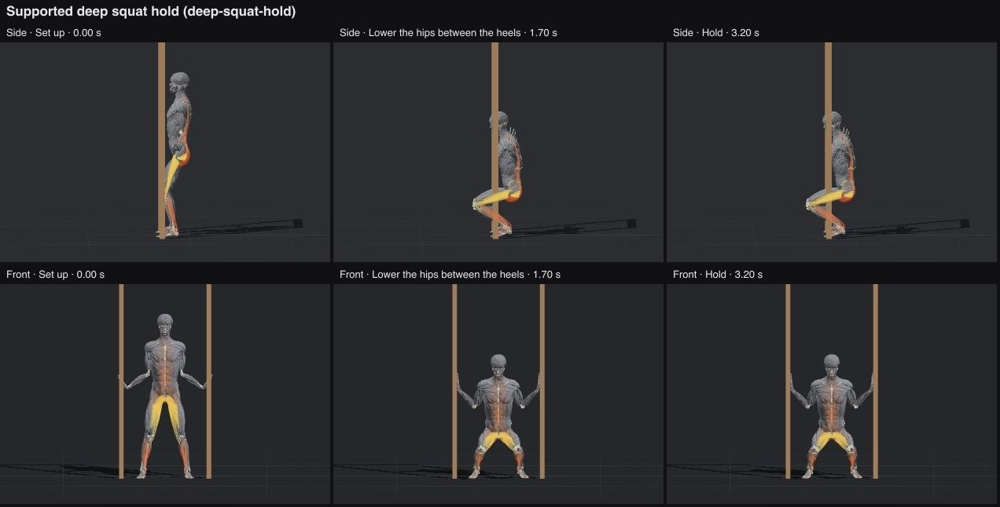

# Motion physics and natural form

2026-11-27 · Active · Every demonstration must rest on what holds it up, balance, keep planted
feet still, stay inside human joint ranges and move smoothly. This plan records what was added to
enforce that, what it fixed, and which of the 189 guides still fail.

## What exists

- **`src/motion/physics/`**: `body.ts` (centre of mass from de Leva segment masses, contact
  witnesses of the performer and of the bare atlas tissue, support polygon), `policy.ts` (every
  tolerance and documented exception in one place) and `analyse.ts` (the per-guide report).
- **`npm run check:physics`** (also inside `check:studio`): samples each guide at 60 Hz and reports
  floating or sinking, resting segments (sit bones for a seat, shins for kneeling…), atlas tissue
  rest, centre of mass over the base of support, planted-foot sliding, point and joint
  acceleration pops, shimmer in holds, and how far a hand's contact mark is from the hand.
  `checks/physics-known.json` lists the guides that still fail and the kinds of failure; the check
  fails on any guide or kind not in it. `npm run check:physics:all` prints every failure.
- **Support solver**. Guides ground themselves in `guides/ground.ts`. Floor-sitting postures rest
  on pelvis, thighs and target tissue, not on the lowest heel, and legs that would sink are lifted
  by a few degrees of hip (`clearFloorFeet`). Free-form Motion Lab clips derive their root height
  from contact (`restOnFloor`); a clip that jumps, hangs or rests on a prop sets `airborne`. The
  floating prone body of the owner's screenshot was a hand-set root height.
- **Hip angles**. `hipAngles` / `hipFromAngles` (exact inverse of `setLeg`) let a guide move its
  hips by anatomical angle between beats (`ANGLE_HIPS` in `sampleGuide.ts`); only the 90/90 uses it.
- **Skills** in `.claude/skills/`: `exercise-authoring`, `biomechanics-physics`, `motion-qa`.

## Cases fixed

- **Supported deep squat hold**: heels flat, hips back and low (hip about 117°, knee about 147°,
  ankle dorsiflexed about 25°), knees over turned-out toes, a handshake grip on the frame at arm's
  length so it works as a counterweight, still hold.
- **90/90 hip switch**: front hip flexed 100° and turned out 75° with the shin flat across the
  body; back hip turned in 55° with the pelvis tilted toward the front leg; hips square, hands on
  the floor behind or on the front shin; a full switch through knees-up to the other side and
  back, with every hip inside its range on every frame.
- **Floating prone/custom clips**: root height derived from contact.

## Still failing

`checks/physics-known.json` has 127 guides. Counts by kind: hand contact out of reach 65, joint
acceleration pops 68, point pops 61, balance 51, foot slide 28, floating 15, penetration 5, atlas
floating 4, hold motion 3. The main causes:

- Hand marks beyond arm length (floor palms in lunges, heel sit, pigeon, quadruped): the body
  pose (trunk lean, root height) must change, not the mark. Owned jointly with the hands plan.
- Arm and leg solvers choosing a different elbow, forearm roll or knee swing from one frame to the
  next when a target sits at a joint limit. Fix the pose first; only then the solver.
- Sit-on-floor guides whose arm solve flips when the body rests on its pelvis (`SIT_EXCLUDED` in
  `ground.ts`: single-leg-seated-hamstring, towel-calf, seated-rotation).
- Weight carried on a prop (roller, pillow, bed, step) is not modelled; those guides are checked
  for penetration only.
- The bare atlas rests on a 12 mm cushion of tissue it cannot draw; four guides rest higher.

## Reference data

No motion-capture data is used. Open datasets such as CMU Mocap (free for any use, no
redistribution as a database), AMASS (licence restricts commercial use) and CMU's BVH conversions
would help judge squat and fold tempo, but licences must be checked per dataset and the owner told
before anything is added; at most they would be used as reference curves, never shipped.

## Next

1. Audit the 127 guides with the skills; remove entries from `physics-known.json` as they pass.
2. Fix the arm solver's branch flipping at joint limits (one cause of most pops).
3. Model roller, pillow, bed and step support in the check.

## Stills (before and after)

Rendered with `npm run stills:guides`; no video was recorded.

| Case                      | Before                                                    | After                                                   |
| ------------------------- | --------------------------------------------------------- | ------------------------------------------------------- |
| Supported deep squat hold |     |     |
| 90/90 hip switch          |  |  |
