# Motion physics and natural form

2026-11-27 · Active · Every demonstration must rest on what holds it up, balance, keep planted
feet still, stay inside human joint ranges and move smoothly. This plan records what was added to
enforce that, what it fixed, and which of the 189 guides still fail.

## What exists

- **`src/motion/physics/`**: `body.ts` (centre of mass from de Leva segment masses, contact
  witnesses of the performer and of the bare atlas tissue, support polygon), `policy.ts` (every
  tolerance and documented exception in one place) and `analyse.ts` (the per-guide report).
- **`npm run check:physics`** (also inside `check:studio`): samples each guide at 60 Hz and reports
  floating or sinking, resting segments (sit bones for a seat, shins for kneeling…), atlas tissue
  rest, centre of mass over the base of support, planted-foot sliding, point and joint
  acceleration pops, shimmer in holds, and how far a hand's contact mark is from the hand.
  `checks/physics-known.json` lists the guides that still fail and the kinds of failure; the check
  fails on any guide or kind not in it. `npm run check:physics:all` prints every failure.
- **Support solver**. Guides ground themselves in `guides/ground.ts`. Floor-sitting postures rest
  on pelvis, thighs and target tissue, not on the lowest heel, and legs that would sink are lifted
  by a few degrees of hip (`clearFloorFeet`). Free-form Motion Lab clips derive their root height
  from contact (`restOnFloor`); a clip that jumps, hangs or rests on a prop sets `airborne`. The
  floating prone body of the owner's screenshot was a hand-set root height.
- **Hip angles**. `hipAngles` / `hipFromAngles` (exact inverse of `setLeg`) let a guide move its
  hips by anatomical angle between beats (`ANGLE_HIPS` in `sampleGuide.ts`); only the 90/90 uses it.
- **Skills** in `.claude/skills/`: `exercise-authoring`, `biomechanics-physics`, `motion-qa`.

## Cases fixed

- **Supported deep squat hold**: heels flat, hips back and low (hip about 117°, knee about 147°,
  ankle dorsiflexed about 25°), knees over turned-out toes, a handshake grip on the frame at arm's
  length so it works as a counterweight, still hold.
- **90/90 hip switch**: front hip flexed 100° and turned out 75° with the shin flat across the
  body; back hip turned in 55° with the pelvis tilted toward the front leg; hips square, hands on
  the floor behind or on the front shin; a full switch through knees-up to the other side and
  back, with every hip inside its range on every frame.
- **Floating prone/custom clips**: root height derived from contact.

## Still failing

`checks/physics-known.json` lists 95 guides (125 before phase 2), and every kind listed for a guide
was already listed on `main`. Guides by kind: hand contact out of reach 48, balance 38, foot slide 26,
floating 12, penetration 5, hold motion 3, atlas floating 3, point pops 1. Joint pops are gone.
Run `npm run check:physics:all` for the list. The main causes left are pose authoring, one
guide at a time:

- Hand marks beyond arm length or on a limb that is not yet there (a contact kept in force from
  the start pose; wrist and finger stretches on the other hand; own-leg marks on a straight leg).
- Weight-bearing balance of floor and kneeling poses whose support polygon is thin (the check sees
  only skin within 30 mm of the floor).
- Planted feet that drift while the pelvis folds (child's pose, kneeling and heel-sit guides).
- Bespoke supports (`supports.ts`) for frog, thread the needle and scorpion that lift the body.

## Phase 2: removing the systemic causes

What changed in `sampleGuide.ts`, `anatomy.ts` and the checks, and why:

- **A beat is a fixed point of the sampler.** Beats were stored after solving the legs only, while
  every sampled frame locks the feet, re-solves the legs, rests the whole body on the floor and
  then places the hands. A beat and the frame after it therefore differed by up to 3 cm and 14° of
  forearm roll, which showed as a pop wherever a hold ended. Beats are now captured through the
  same steps, the body is rested once after the hands have cleared the floor, and a hand that is
  already on its contact is not placed again inside a hold.
- **Each guide is baked once at 60 Hz and low-passed** (about 27 ms Gaussian on the joint rotations
  and root, zero-phase). The elbow and knee swing searches pick the nearest of several nearly equal
  solutions and the winner can change between frames. A hold is untouched, because smoothing a
  constant returns it exactly. The gap at the edge of every beat is carried away over nine frames
  first, so the filter never smears a step into a hold; the first and last frame of a take stay
  exactly the authored pose, so a repeated take has no seam.
- **The swing search settles inside its grid cell** (golden-section refine) for arms always and for
  legs between beats, so a limb does not step a whole grid cell when the winner changes.
- **Breathing is part of the hold.** Held-stretch breathing swells from nothing at the start of a
  hold to nothing at its end and is a few millimetres at the hands; the breathing exercises keep
  the deep whole-clip breath.
- **Props are modelled in `check:physics`.** `physics/props.ts` holds a height field for the
  rollers, pillow, ball, bed and step, and the check measures contact, sinking and balance of the
  head, trunk, pelvis and thighs (or the foot, on a step) against the prop instead of the floor.
  The grounding rests the back on the ball and the bed the same way. The bare atlas tissue is still
  not judged against a prop.
- **The long sit rests on its pelvis with the heels down** (hip flexion 93° instead of 88°), and
  the `SIT_EXCLUDED` exception is gone: single-leg seated hamstring, towel calf and seated
  rotation are ordinary floor sits now.

## Decisions for the guides that put the hands behind the body

| Guide                  | Choice                                                                                                                                                                                                                                                                                                                                                                                              |
| ---------------------- | --------------------------------------------------------------------------------------------------------------------------------------------------------------------------------------------------------------------------------------------------------------------------------------------------------------------------------------------------------------------------------------------------- |
| `heel-sit-lean-back`   | Changed pose, flat palms. The hands rest on the thighs first, then the trunk tips back from the hips (pelvis -45°, spine -35°) and the palms go flat just behind the hips with the elbows about 30° bent and the wrists at 62°. The thighs stay flat as it tips.                                                                                                                                    |
| `seated-reverse-reach` | Flat palms with the fingers turned out. Turned out the wrists stay at 75° and the shoulders are not at end range; the trunk leans back a little so the arms are slightly bent, and the head stays level.                                                                                                                                                                                            |
| `seated-rotation`      | Flat supporting palm just behind the hip, fingers turned out, trunk leaning back about 24° so the arm is bent. The wrist is about 85° at the start of the turn, which a clinician should confirm.                                                                                                                                                                                                   |
| `inchworm`             | Not resolved. The walk-in phase lifts the heels of the hands by design (the wrists are near the end of their range as the shoulders pass over the hands). A flat-palm version breaks the wrist range and sinks the fingers during the walk; a fingertip contact is the intended decision but its mark is not authored yet, so it stays in `PHYSICS_PENDING` in `check:hands` and in the known list. |

The 90/90 back-leg internal rotation was rechecked: with 55° of internal rotation the back shin lies
flat and the guide passes; at 48° and below the pelvis and back thigh hover (floating 67 mm and
more), so the value stays. 55° is at the top of normal hip internal rotation in flexion.

## Stills (phase 2, before and after)

Rendered with `npm run stills:guides`; no video was recorded. Each sheet shows 0, 0.9 and 1.7 s from
the side with the human figure.

| Guide                         | Before                                                                    | After                                                                   |
| ----------------------------- | ------------------------------------------------------------------------- | ----------------------------------------------------------------------- |
| `heel-sit-lean-back`          | 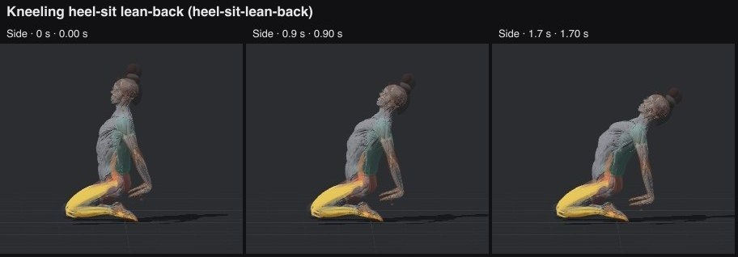          | 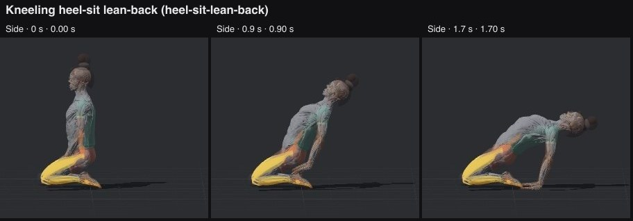          |
| `seated-reverse-reach`        | 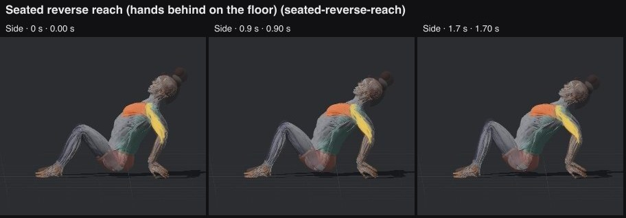        | 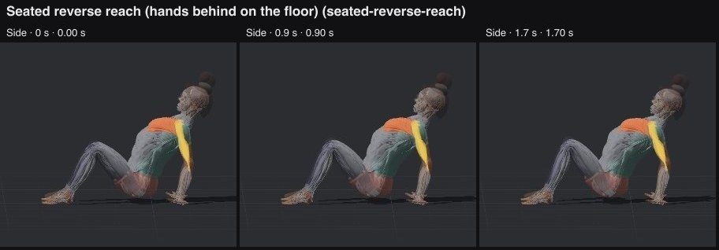        |
| `seated-rotation`             | 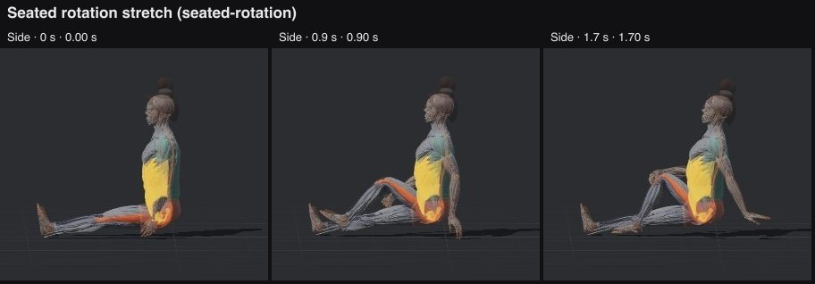             | 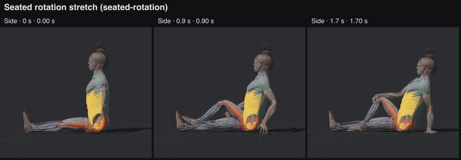             |
| `puppy-pose`                  | 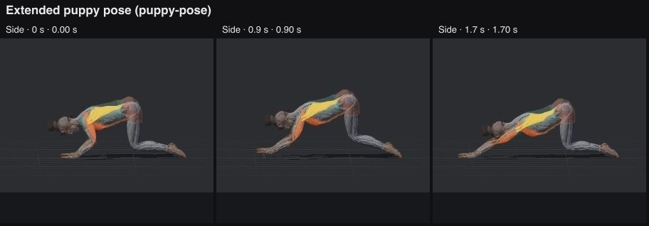                  | 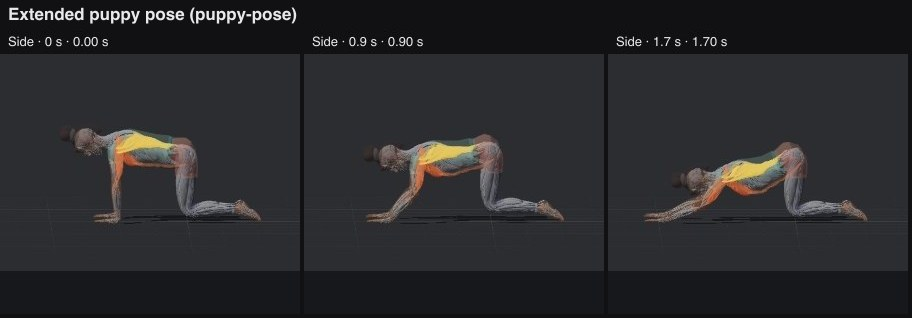                  |
| `knee-to-chest`               | 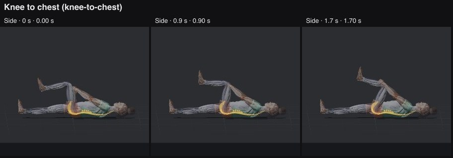               | 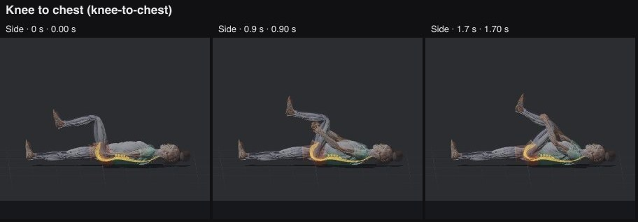               |
| `seated-forward-fold`         | 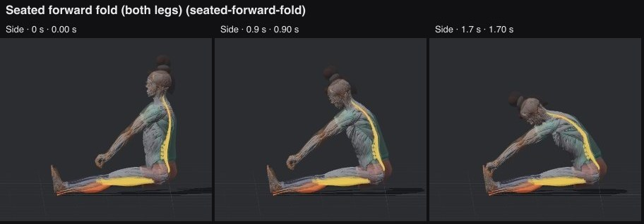         | 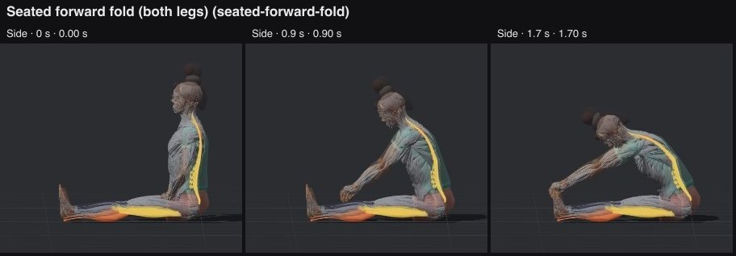         |
| `doorframe-lat`               | 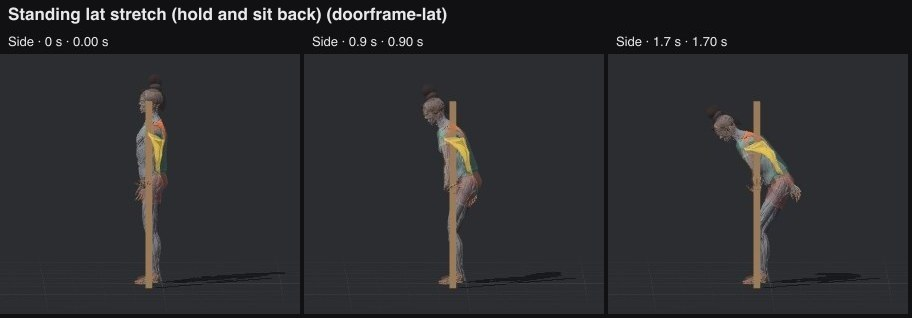               | 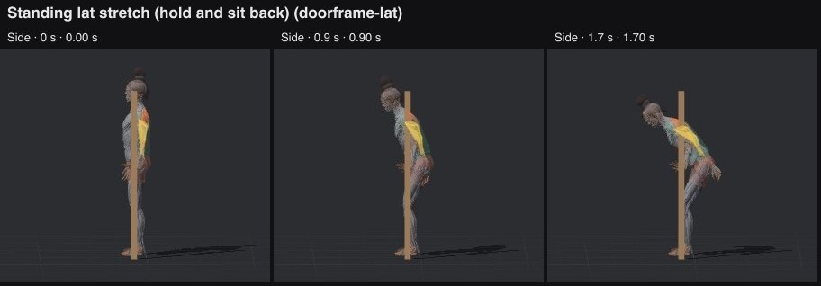               |
| `pigeon`                      | 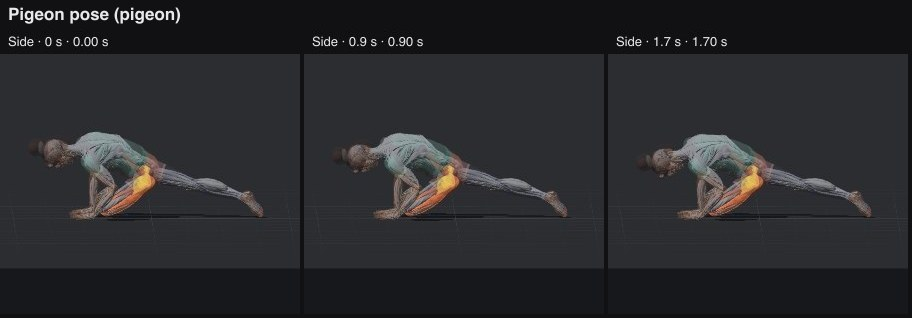                      |                       |
| `all-fours-thoracic-rotation` |  | 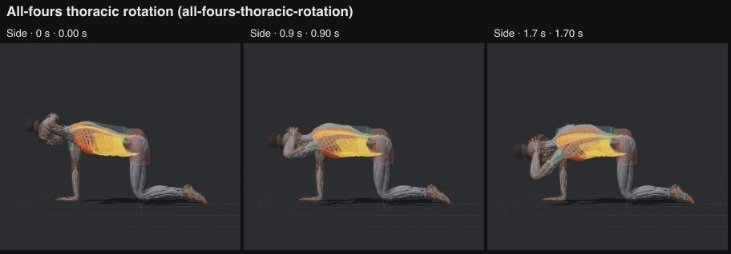 |
| `sphinx`                      | 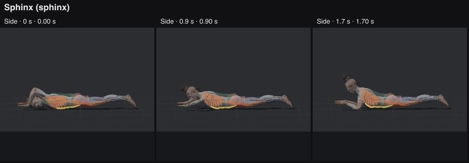                      | 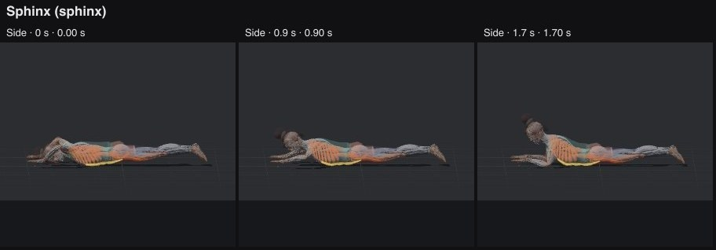                      |
| `childs-pose`                 | 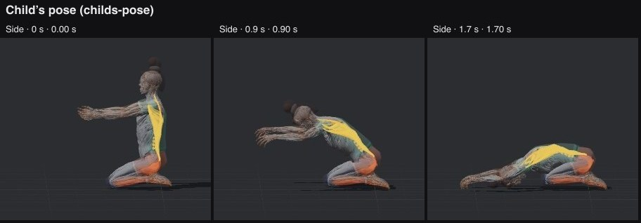                 | 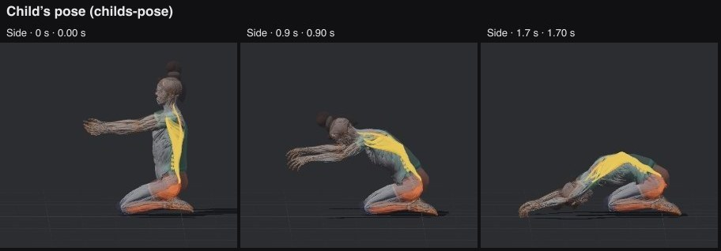                 |

## Reaching the floor

`leanToReach` (`sampleGuide.ts`) folds the body until a floor hand is within arm length: spine
flexion first (up to 38°), then, in postures that hinge at the hips (stand, lunge, split, half
kneel), the pelvis over the thighs (up to 45°); where the hand is behind the hips it leans back
instead (up to 12°). The root height stays where the legs put it. With it, `check:hands` no longer
needs lunge-with-rotation, cat-cow, kneeling-back-extension, all-fours-thoracic-rotation,
adductor-rock-back and seated-straddle in its pending list, and the pigeon and 90/90 poses were
re-authored so their hands reach. Four guides stay pending (heel-sit-lean-back,
seated-reverse-reach, seated-rotation, inchworm): their palms sit 58-240 mm above the floor not
because the arm is short but because a flat palm behind the body needs more shoulder and wrist
range than the pose allows; they need a different hand contact (fingertips, fist or forearm) or a
different exercise pose, a decision for the hands owner and the guide author.
Weight-bearing wrist extension of 79-86° in the quadruped poses is within normal range for a flat
palm under a vertical forearm (push-up posture), so it was not reduced.

## Reference data

No motion-capture data is used. Open datasets such as CMU Mocap (free for any use, no
redistribution as a database), AMASS (licence restricts commercial use) and CMU's BVH conversions
would help judge squat and fold tempo, but licences must be checked per dataset and the owner told
before anything is added; at most they would be used as reference curves, never shipped.

## Next

1. Work the 95 remaining guides one family at a time (contacts that cannot be reached, thin support
   polygons, drifting feet), removing entries from `physics-known.json` as each passes.
2. Resolve the inchworm hand contact (fingertips) and add its mark.
3. Judge the bare atlas tissue against a prop as well as the skin.

## Stills (before and after)

Rendered with `npm run stills:guides`; no video was recorded.

| Case                      | Before                                                    | After                                                   |
| ------------------------- | --------------------------------------------------------- | ------------------------------------------------------- |
| Supported deep squat hold |     | 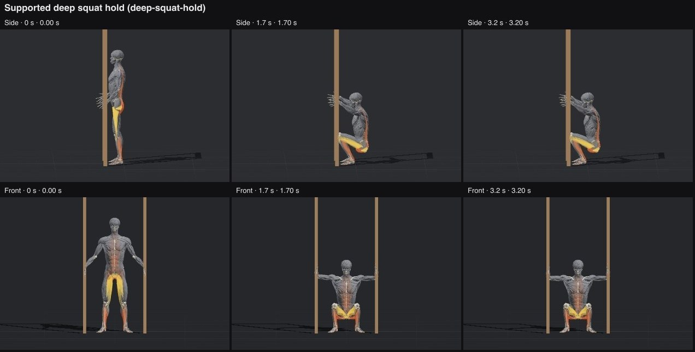    |
| 90/90 hip switch          | 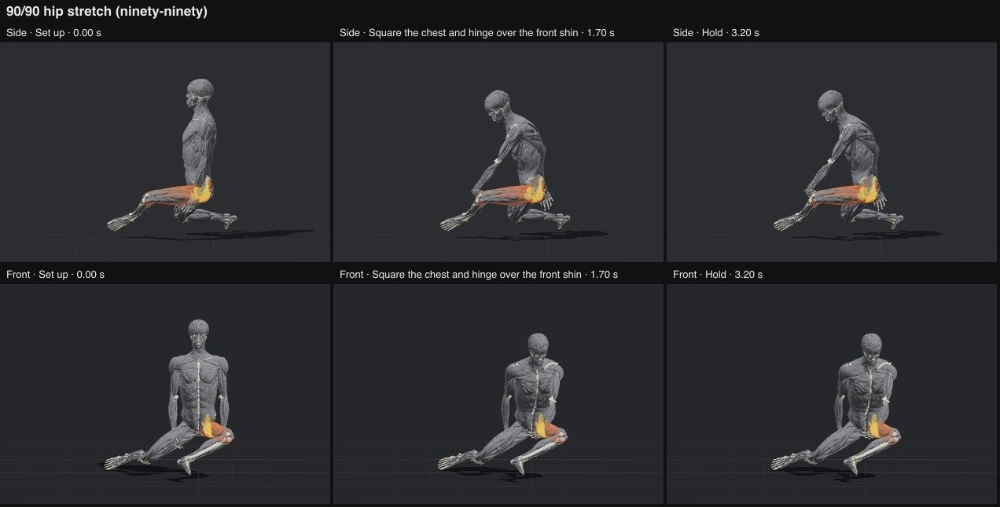 | 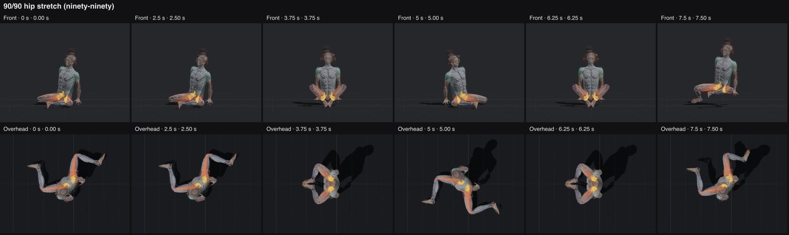 |
